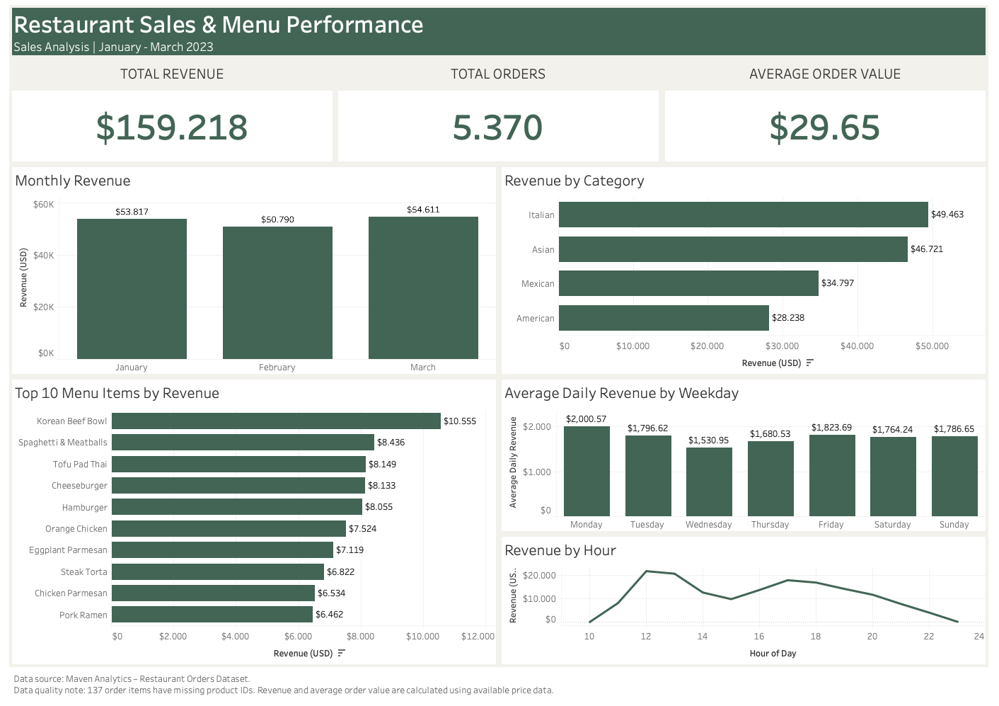

# Restaurant Sales & Menu Performance Analysis

## Project Overview

This end-to-end data analytics project explores restaurant sales performance during the first quarter of 2023. The main objective is to identify sales trends, evaluate menu performance, understand ordering patterns, and provide actionable business recommendations.

## Tools & Technologies

- **Microsoft Excel** – data exploration and preparation
- **Power Query** – data cleaning, transformation and merging
- **MySQL (DBeaver)** – data analysis and KPI calculations
- **Tableau** – interactive dashboard and data visualization

## Dataset

Source: [Maven Analytics – Restaurant Orders](https://mavenanalytics.io/data-playground/restaurant-orders)

- Date range: January – March 2023
- 12,234 order records
- 5,370 unique orders
- 32 menu items
- 4 cuisine categories

## Data Preparation

- Verified data types and unique identifiers.
- Checked for duplicates and missing values.
- Merged order details with menu items.
- Extracted weekdays and order hours.
- Created a data quality status column.
- Retained records with missing product identifiers.

## Key Performance Indicators

| Metric | Value |
|---|---:|
| Total Revenue | $159,217.90 |
| Total Orders | 5,370 |
| Identified Items Sold | 12,097 |
| Average Order Value | $29.65 |

## Key Findings

- Italian cuisine generated the highest revenue ($49,462.70), while Asian cuisine had the highest sales volume.
- Korean Beef Bowl generated the highest revenue ($10,554.60), despite Hamburger being the most frequently ordered item.
- Monday recorded the highest average daily revenue ($2,000.57).
- Sales peaked during lunch hours, with a second peak in the early evening.
- February had the lowest monthly revenue but the highest average order value ($30.14).

## Business Recommendations

- Review staffing levels during peak ordering hours.
- Increase the visibility of high-revenue menu items.
- Consider targeted promotions during slower periods, particularly Wednesdays.
- Investigate factors contributing to higher average order values in February.

## Dashboard

An interactive Tableau dashboard was developed to visualize sales performance, menu performance and ordering patterns, with dynamic filtering by month.

## Data Limitations

The dataset contains 137 order records with missing product IDs. Revenue and average order value are calculated using available price data and may therefore underestimate actual sales revenue.

The dataset does not contain cost information, so profitability cannot be assessed.

## Repository Structure

| File | Description |
|---|---|
| `restaurant_analysis.sql` | SQL queries used for sales analysis, KPI calculations and menu performance evaluation. |
| `menu_items.m` | Power Query transformations for the menu dataset. |
| `sales_analysis.m` | Data cleaning, table merging, feature extraction and data quality checks. |
| `dashboard.png` | Preview of the interactive Tableau dashboard. |

## Reproducing the Analysis

1. Download the original dataset from Maven Analytics.
2. Import the CSV files into Excel using Power Query.
3. Apply the provided M scripts, adjusting the source file paths.
4. Import the original dataset into MySQL and execute the SQL queries.
5. Use the cleaned dataset to create visualizations in Tableau.

The dashboard is currently available as a static preview due to a Tableau Public publishing issue.
